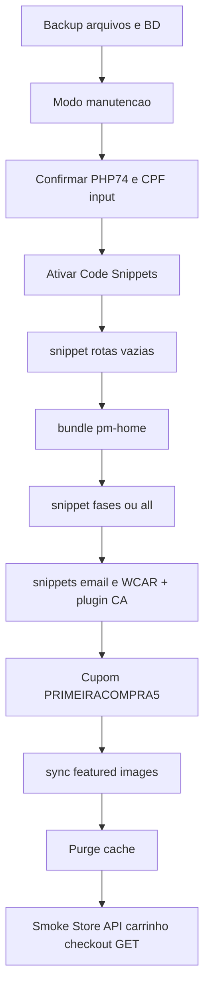

# 06 — Plano de migração (cutover)

**Pré-requisito:** GO explícito da diretoria + este checklist ([09](09-checklist-final.md)).  
**Ferramenta:** `scripts/pm_publicar_destino.py`  
**Env:** `projeto-migracao/.secrets/loja.env` com `--prefix PM_LOJA --permitir-loja`  
**Esta página documenta o futuro GO — não executa nada.**

## Estratégia

Overlay de front + snippets + plugins na loja viva. Banco de clientes/pedidos/Accesstage permanece. Preferência: **fases** como no ensaio 17/10 ([historico/12](../historico/12-cronograma-loja-oficial.md)); `--all` só se a janela de manutenção for única e curta.



## Etapas detalhadas

### 0 — Backup e preparação

1. Backup completo (arquivos + BD) **fora** do clone/OficialTeste.  
2. Modo manutenção (público não compra).  
3. Salvar HTML de `/` e `/finalizar-pagamento/` como referência.  
4. Confirmar `X-Powered-By: PHP/7.4.x`, `input name="cpf"`, `wpcf7-f1831`, `cart-number`.

### 1 — Code Snippets

- Ativar plugin `code-snippets` (já instalado).  
- Comando:  
  `python scripts/pm_publicar_destino.py --env projeto-migracao/.secrets/loja.env --prefix PM_LOJA --permitir-loja plugin`

### 2 — Endpoint de bundle

- `… snippet --routes=""` (ou `none`) — cria/atualiza snippet `pm-home` só para expor REST.  
- State: `loja.state.json` ao lado do env (novo; **não** reutilizar ids do OT).

### 3 — Bundle

- `… bundle` — sobe `wordpress-loja/pm-home` (conta.html, account.php, c24, pages, products…).  
- Verificar `uploads/pm-home/home.html` e `home.css` legíveis.

### 4 — Rotas (fases recomendadas)

| Ordem | Rotas | Teste mínimo |
|-------|-------|--------------|
| 4a | `home` | Header projeto; checkout ainda com CPF |
| 4b | `+masculino,produto` | PDP abre; Store API add-item |
| 4c | `+carrinho` | UI projeto; qty/cupom |
| 4d | `+conta` | Login/cadastro |
| 4e | `+shell` | Chrome checkout; CPF ainda input |
| 4f | `+loja` | pages.json |

Alternativa janela única: `snippet --all` após smoke de CPF.

### 5 — E-mail + WCAR

1. Instalar/ativar `woo-cart-abandonment-recovery`.  
2. Publicar código de `pm_email_styles_snippet.php` e `pm_wcar_snippet.php` (PUT Code Snippets na loja; adaptar scripts que hoje apontam OT).  
3. Confirmar `pm-wcar/v1` ou tela Woo → Cart Abandonment.

### 6 — Cupom e imagens

- Criar `PRIMEIRACOMPRA5` se ausente (5%, 1× cliente, primeira compra).  
- `python scripts/_sync_woo_featured_images.py --env …/loja.env --allow-prod` (somente com GO).

### 7 — Segurança (doc 21, sem apagar clientes)

- Revogar app passwords antigas se comprometidas; manter `loja.env` atual se válida.  
- Remover posts spam e users fake **sem pedidos**.  
- Não truncar clientes reais.

### 8 — Purge e smoke

- Purge LiteSpeed/Hostinger CDN.  
- Bust `?v=` / `?pm=` se cache grudar.  
- Smoke: Store API → `/carrinho/` → GET `/finalizar-pagamento/` (CPF input). **Sem** pagamento até [07](07-plano-testes.md).

### 9 — Limpeza BD/mídia

- **Depois** do cutover estável ([historico/18](../historico/18-limpeza-bd-pos-migracao.md)): sessões/transients expirados, mídia órfã. Não no minuto zero.

## O que será / não será

| | |
|--|--|
| Migrado | Bundle, 3 snippets, WCAR plugin, cupom, sync imagens |
| Mantido | Users, pedidos, Accesstage, CF7, PHP 7.4, admins |
| Atualizado | Superfície das rotas do projeto |
| Substituído (GET) | Home Elementor → `home.html` enquanto ativo |
| Não alterado | Gateway, formulário pagamento, BD clientes |

## Reversão

| Severidade | Ação |
|------------|------|
| Front ruim / 404 | `snippet --off` ou desativar snippet pm-home |
| CPF sumiu / PHP | **Restore backup** imediato — não só `--off` |
| WCAR barulhento | Desativar snippet WCAR + plugin |

## Comandos-modelo (GO futuro)

```text
python scripts/pm_publicar_destino.py --env projeto-migracao/.secrets/loja.env --prefix PM_LOJA --permitir-loja plugin
python scripts/pm_publicar_destino.py --env projeto-migracao/.secrets/loja.env --prefix PM_LOJA --permitir-loja snippet --routes ""
python scripts/pm_publicar_destino.py --env projeto-migracao/.secrets/loja.env --prefix PM_LOJA --permitir-loja bundle
python scripts/pm_publicar_destino.py --env projeto-migracao/.secrets/loja.env --prefix PM_LOJA --permitir-loja snippet --routes home,masculino,produto,carrinho,conta,shell,loja
```

Nunca usar `oficialteste.env` como destino da loja.
