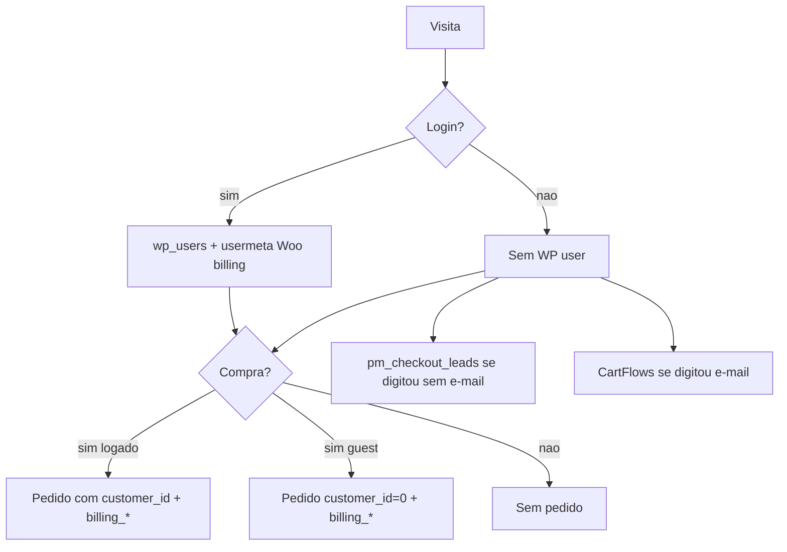

# Mapa de identidades / cadastros (conta + checkout)

Atualizado em 30/10/2026 após o switch Entrar|Cadastre-se em `/minha-conta/` (OficialTeste). Loja oficial fora do escopo.

## Fluxo

## Armazéns

| Armazém | Chave | Dados | Sensível | Dedupe atual |
|---|---|---|---|---|
| `wp_users` / customer | e-mail (login) | conta, senha hash | senha | `wc_create_new_customer` recusa e-mail existente |
| Woo billing usermeta | user_id | nome, telefone, endereço, e-mail | telefone/endereço | um perfil por user |
| Pedido Woo | order_id; `customer_id` e/ou `billing_email` | cópia do checkout no pedido | PII no pedido | lista em Minha conta junta `customer_id` + `billing_email` e deduplica por id do pedido |
| `wp_pm_checkout_leads` | lead_id / e-mail / telefone | nome, telefone, CPF, unidade, carrinho | CPF | apaga no pedido pago (e-mail ou últimos 8 dígitos do telefone); retenção 30 dias |
| CartFlows abandon | session + e-mail | carrinho + other_fields | PII parcial | reaproveita linha do mesmo e-mail (30 dias); pedido pago remove `normal` |
| `pm-identity-v1` + cookie `pm_lead_id` | browser | e-mail/nome/telefone/CPF | no device | só local; alimenta captura |

## Rotas cobertas

1. **Login sem compra** — só `wp_users` + usermeta; sem pedido, sem lead.
2. **Login + checkout** — pedido com `customer_id` = user; billing_* do perfil/checkout; WCAR `{{customer.firstname}}` usa `billing_first_name` / `first_name` / `display_name` (cadastro agora grava os três + `billing_phone`).
3. **Guest checkout** — pedido `customer_id=0` + `billing_*`; sem conta WP.
4. **Guest digita parcial sem e-mail** — `wp_pm_checkout_leads` (+ identidade local); CartFlows não grava sem e-mail.
5. **Guest abandona com e-mail** — CartFlows (linha do e-mail, janela 30 dias) + lead se houver.
6. **Depois cria conta com o mesmo e-mail** — `wc_create_new_customer` cria **uma** conta; pedidos guest anteriores aparecem na lista por `billing_email`. **Não** há merge de users: regra é 1 conta por e-mail.

## Cadastro em `/minha-conta/` (desde 30/10)

- Um card com switch Entrar | Cadastre-se (padrão Entrar).
- Cadastro exige Nome + Telefone + e-mail + senha.
- PHP grava `first_name`, `display_name`, `billing_first_name`, `billing_phone` (e `billing_email` se vazio).
- CTA pedidos vazios: `btn-lux-primary` + `text-on-primary`.

## Detalhe do pedido (autorização)

`pm_account_order` autoriza se `order->get_user_id() === current_user` **ou** se `billing_email` do pedido (trim + lowercase) for igual ao `user_email` da conta — a mesma regra da lista. Pedido guest listado por e-mail abre o detalhe; order_id de outro e-mail continua “Pedido não encontrado.” (corrigido 30/10/2026 no OficialTeste).

## Arquivos

- WP: `wordpress-loja/pm-home/conta.html`, `account.js`, `account.php` (via snippet + bundle OficialTeste).
- Next preview: `src/components/AuthModal.tsx` + `StoreProvider` (mock localStorage, não WP).
