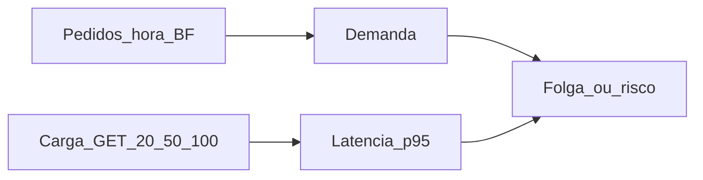

# 25 — Capacidade GET × Black Friday 2024/2025 × PSI (loja)

Relatório cruzando ensaio de carga/PSI (out/2026) com **pedidos WooCommerce reais** de novembro/2024 e **novembro/2025**. Sem POST de pagamento; sem inventar pageviews.

**Fontes:**

- Carga: [`22-carga-loja.md`](22-carga-loja.md) / síntese [`24`](24-desempenho-loja-psi-carga.md)
- PSI: [`23-psi-loja-baseline.md`](23-psi-loja-baseline.md)
- Pedidos: `GET /wp-json/wc/v3/orders` loja → [`.secrets/bf-2024-orders-loja.json`](../.secrets/bf-2024-orders-loja.json) + [`.secrets/bf-2025-orders-loja.json`](../.secrets/bf-2025-orders-loja.json) (script [`scripts/_report_bf_orders_loja.py`](../../scripts/_report_bf_orders_loja.py) `2024|2025`)
- Analytics: GTM `GTM-52G8XVQ8` no front — **sem export GA4 no repo** (ver §5)

---

## 1. Capacidade GET → segundos (SLA sob carga)

Ensaio GET-only (HTML + assets `pm-home`; checkout só warm-up leve). Abort se erro >5% ou p95 HTML >8 s — **não abortou**.

| Concorrência (workers ≈ VUs) | p50 | p95 HTML | RPS | Leitura operacional |
|------------------------------|----:|---------:|----:|---------------------|
| **~20** | **~1,2 s** | **~1,9 s** | ~16 | Zona confortável — página “rápida” |
| **~50** | **~2,5 s** | **~3,4 s** | ~23 | Estável; começa a pesar |
| **~100** | **~5,1 s** | **~7,6 s** | ~24 | Saturado (RPS quase flat 50→100); perto do teto 8 s |

**Em linguagem de negócio:** com ~20 pessoas batendo GET ao mesmo tempo, a loja responde em cerca de **2 s** no pior razoável (p95). Com ~50, sobe para **~3–3,5 s**. Com ~100, o usuário espera **~5–8 s** só no HTML — a loja “não cai”, mas parece lenta.

Checkout **POST** (CF7 → Accesstage, tipicamente **~5–15 s**) é gargalo **separado**: não entrou no stress GET; o overlay cobre a UX, não a capacidade do host nesse ensaio.

**Capacidade confortável sugerida (ensaio atual):** **20–50** sessões GET concorrentes neste perfil.

---

## 2. Demanda Black Friday 2024 (Woo — pedidos)

Janela: **2024-11-01 → 2024-11-30**. Status pedidos retornados pela API na prática: **100% `completed`** (1.619). GMV completed: **R$ 220.392,73** · AOV **R$ 136,13**.

### Médias diárias

| Recorte | Pedidos/dia (média) |
|---------|--------------------:|
| Novembro inteiro | **54,0** |
| 1ª semana (01–07/11) — baseline | **20,4** |
| Semana BF (25–30/11) | **138,0** |
| Fator semana BF ÷ 1ª semana | **×6,76** |

(O doc [`18`](18-limpeza-bd-pos-migracao.md) falava em pico “~2×” de forma qualitativa; nos **pedidos** de nov/2024 o salto da semana BF vs início do mês é bem maior.)

### Dias da semana BF

| Dia | Pedidos |
|-----|--------:|
| 25/11 | 79 |
| 26/11 | 76 |
| 27/11 | 91 |
| 28/11 | 127 |
| **29/11 (sexta BF)** | **265** |
| 30/11 | 190 |

### Pico por hora (top)

| Hora (relógio do Woo) | Pedidos |
|-----------------------|--------:|
| **2024-11-29 21:00** | **24** |
| 2024-11-29 15:00 | 23 |
| 2024-11-29 17:00 | 23 |
| 2024-11-29 13:00 | 21 |
| 2024-11-28 16:00 | 18 |
| 2024-11-29 14:00 / 23:00 | 18 |
| 2024-11-30 14:00 | 18 |

Pico 2024 = **24 pedidos/hora** ≈ **0,4 pedido/minuto**.

---

## 2b. Black Friday 2025 (Woo — pedidos)

Janela: **2025-11-01 → 2025-11-30**. Status: **100% `completed`** (1.547). GMV **R$ 225.514,87** · AOV **R$ 145,78**. Sexta BF BR: **28/11/2025**.

### Médias diárias

| Recorte | Pedidos/dia (média) |
|---------|--------------------:|
| Novembro inteiro | **51,6** |
| 1ª semana (01–07/11) | **31,6** |
| Semana BF (25–30/11) | **123,3** |
| Fator semana BF ÷ 1ª semana | **×3,91** |

### Dias da semana BF 2025

| Dia | Pedidos |
|-----|--------:|
| 25/11 | 67 |
| 26/11 | 72 |
| 27/11 | 91 |
| **28/11 (sexta BF)** | **190** |
| 29/11 | 134 |
| **30/11** | **186** |

### Pico por hora (top)

| Hora | Pedidos |
|------|--------:|
| **2025-11-30 22:00** | **32** |
| 2025-11-30 21:00 | 25 |
| 2025-11-30 23:00 | 21 |
| 2025-11-28 11:00 / 12:00 | 17 |
| 2025-11-21 10:00 / 11:00 | 17 |

Pico 2025 = **32 pedidos/hora** (domingo 30/11 à noite — mais alto que a sexta).

### YoY 2024 × 2025

| Métrica | 2024 | 2025 | Δ |
|---------|-----:|-----:|---|
| Pedidos no mês | 1.619 | 1.547 | −4,4% |
| GMV completed | R$ 220,4k | R$ 225,5k | +2,3% |
| AOV | R$ 136 | R$ 146 | +7% |
| Média/dia nov | 54,0 | 51,6 | −4% |
| Média/dia 1ª semana | 20,4 | 31,6 | +55% (baseline mais alta) |
| Média/dia semana BF | 138,0 | 123,3 | −11% |
| Sexta BF | **265** (29/11) | **190** (28/11) | −28% |
| Pico pedidos/hora | **24** | **32** | **+33%** |
| Fator BF÷week1 | ×6,76 | ×3,91 | baseline 2025 já mais quente |

**Leitura:** volume mensal parecido; sexta BF 2025 mais fraca que 2024, mas o **pico horário subiu** (32/h no dia 30). O “esquenta” e o domingo pós-BF concentraram carga.

---

## 3. Cruzamento: capacidade × BF 2024/2025

### O que os pedidos sozinhos dizem

No pior pico observado (**32 pedidos/h** em 2025), a taxa de conclusão ainda é baixa frente à capacidade GET (16–24 RPS). **Só pedidos** não exigem 100 VUs de HTML.

### Premissas explícitas (proxy; não são pageviews GA)

Usando o pico **32/h** (2025):

| Premissa | Cálculo grosseiro | Concurrent GET estimado |
|----------|-------------------|-------------------------|
| A — só funil checkout: 32/h, ~60 s na página | 32/3600 × 60 | **~0,5** |
| B — navegação: 50× GETs/pedido, ~30 s | (32×50/3600)×30 | **~13** |
| C — agressivo: 100× GETs/pedido, ~45 s | (32×100/3600)×45 | **~40** |

Leitura:

- **A/B:** zona 20 folgada (~1,9 s p95).
- **C:** entra no meio da zona **20–50** (~3,4 s p95) — ainda estável; não satura em 100.
- POST Accesstage: 32/h ≈ **0,53/min**; com ~10 s de gateway, concurrent de charge ≈ **0,1** — brando. Spike de marketing + conversão maior é o cenário a monitorar, não o histórico 2024–25 sozinho.

**Conclusão cruzada:** perfis BF 2024 e 2025 (pedidos) **cabem** na zona confortável GET atual; prioridade continua PSI/UX + confirmar sessões via GA4 antes da próxima BF.

---

## 4. PSI mobile — overview do que dá para melhorar

Baseline loja (1 corrida, doc 23):

| Página | Score | LCP | TBT | Peso | Ação |
|--------|------:|----:|----:|-----:|------|
| home-fem | **91** | 2,1 s | 276 ms | 2,3 MB | Manter |
| home-masc | **54** | 3,3 s | **4,1 s** | 2,6 MB | P3 — auditar JS vs feminina |
| PDP cera/laser | **96** | ~1,9–2,3 s | ~140–180 ms | ~0,9–1,1 MB | OK |
| carrinho | **70** | **7,9 s** | 218 ms | 1,3 MB | P2 — path LCP |
| finalizar-pagamento | **47** | 5,0 s | 751 ms | **4,5 MB** | P1/P4 — GSAP + tema |

### O que dói (e o que não)

- **Checkout:** ~**1,1 MB** unused JS + ~117 KiB unused CSS — quase tudo **tema Shopwise / Elementor / plugins**. Overlay (~9 KB) e shell (~65 KB) **não** explicam o score 47. GSAP (~73 KB) no boot do checkout é ganho barato nosso.
- **Carrinho:** LCP ~7,9 s (1 run) — candidato a imagem/fonte no LCP, não “falta de RPS”.
- **Home masculina:** TBT explode vs feminina (mesmo padrão unused JS ~116 KiB) — diferença de main-thread (~14 s vs ~6 s).
- **Home feminina / PDPs:** já bons; não priorizar.

### Backlog priorizado (sem mexer Accesstage/CF7)

| Pri | Mudança | Risco | Esperado |
|-----|---------|-------|----------|
| **P1** | GSAP do checkout só no 1º clique “Finalizar” | baixo | −73 KB first paint; melhor TBT/LCP checkout |
| **P2** | Investigar LCP `/carrinho/` (imagem/fonte) | médio | score carrinho |
| **P3** | Auditar JS home masculina vs feminina | médio | 54 → ? |
| **P4** | Unused CSS/JS do **tema** no checkout | alto se “limpar” | só inventário fino + GO |
| **P5** | Host/HTML dinâmico sob carga (RPS flat 50→100) | ops | capacidade = hosting/CDN |

**Não mexer:** CF7 #1831, Accesstage, POST pagamento, cupom/totais, limpeza cega de JS do tema.

Patches **não** aplicados neste relatório — backlog para GO separado.

---

## 5. Buraco GA4 / GTM — acessos diários

| Dado | Status |
|------|--------|
| GTM no site | **`GTM-52G8XVQ8`** (`src/lib/analytics.ts`, snippet `pm-home`) |
| GA4 / Clarity / Meta | Vivem **dentro do container GTM** — IDs **não** versionados no repo |
| Sessões/dia, usuários ativos, pico concorrente | **Ausentes** neste relatório |
| Pedidos/dia/hora BF 2024 e 2025 | **Presentes** (Woo REST) |

### Como plugar GA4 depois (sem reescrever o resto)

1. No GA4: Explorar → exportar CSV de **Sessões por dia** (nov/2024 e/ou nov/2025) e, se possível, **usuários ativos / views** na semana BF.
2. Salvar em `projeto-migracao/.secrets/ga4-nov-2024-loja.csv` / `ga4-nov-2025-loja.csv` (gitignored).
3. Acrescentar apêndice neste doc cruzando sessões/dia com as tabelas Woo e recalculando o proxy da §3.

Até lá: **não inventar** média de acessos; usar só pedidos + ensaio GET.

---

## 6. Resumo executivo

1. **Zona segura GET hoje:** 20–50 concorrentes → ~**1,9–3,4 s** p95 HTML; em 100 → ~**7,6 s** e saturação.
2. **BF 2024:** ~54/dia; semana BF **×6,8**; sexta **265**; pico **24/h**.
3. **BF 2025:** ~52/dia; semana BF **×3,9**; sexta **190**; pico **32/h** (30/11 22h) — pico horário maior que 2024.
4. **Cruzamento:** ambos os anos **cabem** na zona 20–50 sob proxies; confirmar pageviews com GA4.
5. **Melhora de percepção:** P1–P3 (GSAP checkout, LCP carrinho, home masc) sem tocar gateway.
6. **Acessos:** só GTM no código; export GA4 ainda falta.
