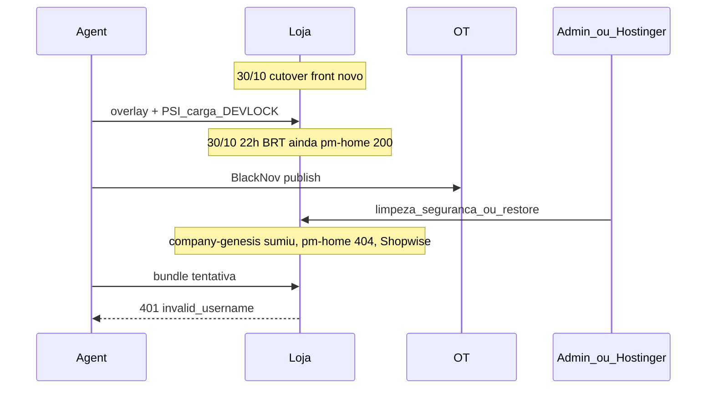

# 29 — Auditoria: o agente reverteu a loja?

Data do relatório: 01/11/2026.  
Âmbito: ações da sessão Cursor em `loja.pellomenos.com.br` desde **31/10/2026 ~01h (BRT)** até agora.  
Fontes: transcript [sessão cutover/loja](7d60709a-2f70-4ea0-821a-c1a54989f2b6) (compaction `segment_005`–`007`), históricos 21–28, [auditoria-cutover-loja/10-relatorio-execucao.md](../auditoria-cutover-loja/10-relatorio-execucao.md), probes live 01/11. Cruzamento: [Audit loja actions since Oct31](d756a8af-1016-479c-b678-90a654175198).

## Veredicto

**Não.** O agente **não** reverteu a loja ao tema antigo (Shopwise).

- Não há execução de `snippet --off` na loja após o cutover — só a **receita documentada** em [como-publicar.md](../como-publicar.md) e no relatório de cutover.
- Em **01/11** a única tentativa de publish (`scripts/_publish_loja_black_and_checkout.py` → `bundle` com `--permitir-loja`) falhou com **401 `invalid_username`** (`company-genesis` já inexistente). Sem auth admin o agente **não podia** desativar snippets nem apagar ficheiros.
- Desligar o snippet **não** apaga `uploads/pm-home/`; em 01/11 essa pasta responde **404**. Isso exige delete/restore no servidor, não um `--off` nosso.

## Nota de relógio

| Artefato | Timestamp UTC | BRT (UTC−3) |
|----------|---------------|-------------|
| PSI [23](23-psi-loja-baseline.md) | `20261031T010403Z` | **30/10 ~22:04** |
| Carga [22](22-carga-loja.md) | `20261031T011736Z` | **30/10 ~22:17** |

O ensaio PSI/carga foi na **noite de 30/10**, não às 01h de 31/10 BRT. A janela pedida (31/10 ~01h → agora) começa **depois** desse ensaio, com o front novo ainda comprovadamente no ar.

Auth `loja.env` (`company-genesis`) ainda respondia pelo menos até **31/10 ~00:30** (busca Woo tintura). Em **01/11** já estava morta.

## Linha do tempo (BRT)

### Antes da janela (front novo no ar)

| Momento | Ação na loja | Resultado |
|---------|--------------|-----------|
| 30/10 tarde | Cutover: `plugin` → `snippet` → `bundle` → rotas (`--permitir-loja`) | Front **novo** ([10-relatorio-execucao.md](../auditoria-cutover-loja/10-relatorio-execucao.md)) |
| 30/10 noite | Logo/shell `c31`/overlay; full zip → `RemoteDisconnected` → slim zip **200** | **OK** na loja |
| 30/10 ~22:02–22:25 | DEV LOCK off → PSI + carga GET → DEV LOCK on | Assets `pm-home` **200**; home ~474 KB ([23](23-psi-loja-baseline.md), [22](22-carga-loja.md), [24](24-desempenho-loja-psi-carga.md)) |
| 30/10 ~22:46 | Fix overlay “Preparando os itens” (shell `c33` / `load2`) | **OK** na loja |
| 30/10 ~23:15–23:26 | Relatório BF ([25](25-capacidade-bf-psi.md)); GET Woo pedidos 2024/2025 | Só leitura REST |
| 31/10 ~00:30 | Busca Woo tintura via `loja.env` | Auth ainda **OK** |

**Nota:** DEV LOCK off/on **não** troca o tema. Só restringe edição/login público.

### Dentro da janela (31/10 ~01:00 → 01/11)

| Momento | O que o agente fez | Escreveu na loja? |
|---------|-------------------|-------------------|
| 31/10 01:02+ | Black Nov: código local + publish **OficialTeste** (snippet #24 FORCE, cart/shell OT) | **Não** (só OT) |
| 31/10 | Tintura provisória ([26](26-black-nov-tintura-pubianos.md)), smoke OT | **Não** |
| ~39 h | Sem comandos na loja no transcript | — |
| 01/11 ~16:36–16:51 | Labels carrinho; publish OT | **Não** |
| 01/11 ~17:35+ | Overlay polish repo (`c35`/`load3`); sync Drive → WebP local | **Não** (disco local) |
| 01/11 | `_publish_loja_black_and_checkout.py` → `bundle --permitir-loja` | **Falhou** 401 |
| 01/11 | Probes auth (users / wp-login / cookies); audit Accesstage OT | Sem escrita |
| 01/11 | Docs [27](27-checkout-anim-imagens-loja-auth.md), [28](28-pagamento-ot-accesstage-nota.md) | Locais |
| 01/11 ~18:40 | Probe live Shopwise vs `pm-home` | Só leitura (home ~186 KB, Shopwise) |

## O que o agente não fez (vasculhado)

- Não correu `pm_publicar_destino.py … --permitir-loja snippet --off` (hits no transcript são docs/greps, não Shell).
- Não apagou `/wp-content/uploads/pm-home/`.
- Não desativou Code Snippets via API com sucesso depois de 31/10 ~01h.
- Não apagou `company-genesis` nem limpou spam.
- Após 01/11: **zero** escrita bem-sucedida na loja.

## Estado live observado em 01/11 (após o rollback)

- `/`, `/carrinho/`, `/minha-conta/` → tema **Shopwise/Elementor** (sem `pm-home`).
- `/masculino/` → **404** (rota do front novo).
- `/wp-content/uploads/pm-home/*` → **404**.
- REST `pm-home/v1` e `code-snippets/v1` → **404** (plugin inativo); pasta `wp-content/plugins/code-snippets/` ainda no disco (**403**).
- Users públicos: `lsb`, `gerencia-admin` — **`company-genesis` ausente**.
- Spam limpo (vs ~1271 no alerta do [21-pos-reuniao-29-10-2026.md](21-pos-reuniao-29-10-2026.md)).

## O que explica a loja antiga (fora do agente)

Intervenção **no hosting / WP admin** entre o ensaio PSI (front novo) e a tarde de 01/11:

1. Tema Shopwise de volta; rota `/masculino/` sumiu.
2. Bundle `pm-home` apagado + Code Snippets inativo.
3. User `company-genesis` removido; spam limpo.
4. `loja.env` inválido → republicação pelo repo bloqueada.

Compatível com limpeza de segurança pedida no histórico 21 (revogar admins / spam) **e/ou** restore de backup pré-cutover — **não** com publish/rollback desta sessão após 31/10 ~01h.

## Como republicar (quando houver credencial)

1. Atualizar `projeto-migracao/.secrets/loja.env` (`PM_LOJA_USER` = admin válido, ex. `lsb` ou `gerencia-admin`, + app password).
2. `python scripts/_publish_loja_black_and_checkout.py`  
   (ou sequência manual: `plugin` → `bundle` → `snippet --routes=…` + Black Nov **sem** FORCE).
