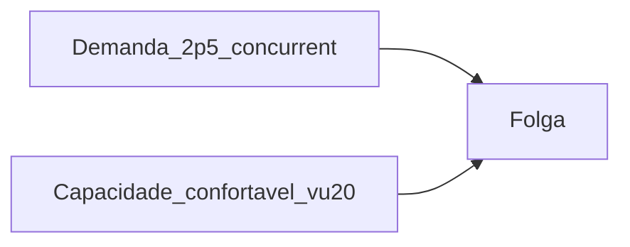

# 39 — Cache, demanda e Minha Conta (05/11/2026)

Ensaio na **loja** após centralizar o spinner de “Verificando login…” e revalidar cache + carga GET.

## 1. Minha Conta — spinner

- Causa: `paintChecking()` usava utilities Tailwind só no JS (`flex` / `items-center` / `min-h-[50dvh]`), fora do CSS purged → bloco no topo/esquerda.
- Correção: CSS **inline** no painel (`display:flex; align-items:center; justify-content:center; min-height:calc(100dvh - 200px)`), texto ASCII `Verificando login...`.
- Publicado: `account.js?v=conta-check2` + `conta.html` via bundle.

## 2. Cache (probe anônimo)

| URL | Cache-Control | Server | Leitura |
|-----|---------------|--------|---------|
| `/`, `/masculino/`, `/carrinho/`, `/minha-conta/` | `public, max-age=120, s-maxage=300` + `Vary: Cookie` | LiteSpeed | Alinhado ao snippet `pm-home` |
| `/wp-content/uploads/pm-home/*` (css/js/png) | `public, max-age=604800` (7 dias) | LiteSpeed | Estáticos OK; bust por `?v=` |
| Conta/logado | (não probe com cookie) | — | Snippet força `private, no-store` com cookie login/carrinho |

Sem headers HIT/MISS explícitos neste probe; CDN/LiteSpeed responde nos estáticos com max-age longo. **Cache estático e HTML anônimo: OK.**

Artefato: `scripts/_audit_loja_cache_headers.json`.

## 3. Demanda recente (Woo, 30 dias)

Janela: **2026-10-06 → 2026-11-05**. Status: `completed,processing`. **318** pedidos em 28 dias com venda.

| Métrica | Valor |
|---------|------:|
| Média pedidos/dia | **11,4** |
| Pico dia | 24 (2026-10-06) |
| Pico hora | **6**/h (ex.: 06/10 23h; 05/11 16h) |
| Pico pedidos/minuto | **0,10** |
| Proxy GETs/min no pico (50 GETs/pedido) | **5,0** |
| Concurrent GET estimado (dwell 30 s) | **~2,5** |

**Sem GA4** no repo (só GTM). “Usuários/minuto” = proxy pedidos × GETs, não sessões GA.

Artefato: `scripts/_report_demand_recent_loja.json`.

## 4. Carga GET (05/11)

Ver [`38-carga-loja-2026-11-05.md`](38-carga-loja-2026-11-05.md).

| Degrau | Workers | Err% | RPS | p95 HTML |
|--------|--------:|-----:|----:|---------:|
| warmup | 5 | 0 | 3,9 | 1,8 s |
| vu20 | 20 | 0 | 13,2 | **2,8 s** |
| vu50 | 50 | 1,3 | 13,8 | **9,2 s** → **abort** |

Comparado a 31/10 ([22](22-carga-loja.md)): vu20 p95 ~1,9 s → hoje ~2,8 s; vu50 ~3,4 s → hoje abortou >8 s. Host mais sensível sob 50 concorrentes do que no ensaio anterior; RPS flat ~13–14 já em vu20–50.

## 5. Cruzamento

- Demanda atual (~2,5 concurrent GET no pico) **cabe folgada** na zona vu20 (~2,8 s p95).
- Não operar mentalmente em 50+ VUs neste host hoje; BF histórico (pico 32 pedidos/h) sob proxy B ainda ~40 concurrent — **monitorar** se a sensibilidade vu50 persistir até a BF.
- Checkout POST Accesstage continua fora do stress GET.

## 6. Veredito

1. **Spinner Minha Conta:** corrigido e no ar (`conta-check2`).
2. **Cache:** HTML anônimo + estáticos `pm-home` conforme desenho; OK.
3. **Demanda atual:** ~11 pedidos/dia; ~0,1 pedido/min no pico — baixa vs capacidade vu20.
4. **Capacidade:** confortável em **~20** VUs; **50** VUs já estoura p95 HTML neste ensaio (pior que 31/10).
